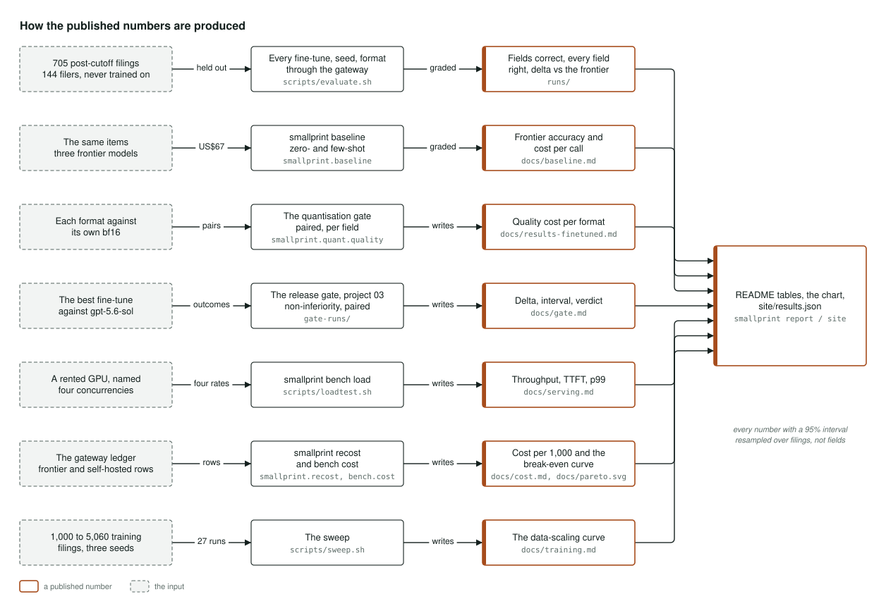

# Architecture

Four figures, one per mechanism: the system as a whole, how the dataset and its labels are
built, the path from a base model to a served and costed endpoint, and how each published
number is produced. Each names the module that implements what it shows; [PLAN.md](../PLAN.md)
says why, and [runbook.md](runbook.md) says the order the work was done in.

## The system

The left column is the data: filings and the XBRL facts filed with them are fetched from SEC
EDGAR under its fair-access rules (`smallprint.data.edgar`, `smallprint.data.xbrl`), the
dataset build locates each filing's primary statements and pairs one filed fact with each field
(`smallprint.data`), and the items are split by company with pre-cutoff and post-cutoff test
sets that no model is trained on (`smallprint.data.split`). The middle column is the models:
the 2B, 4B and 7B bases are fine-tuned with QLoRA on rented GPUs, ablated on rank, learning
rate and data volume over three seeds (`smallprint.train`), merged to bf16 and quantised to
AWQ, GPTQ and GGUF (`smallprint.quant`), published to Hugging Face with the dataset and the
model cards (`cards/`), and served from there with vLLM or llama.cpp on a rented card where
the load test runs (`smallprint.serve`, `smallprint.bench`). The right column is the
measurement: the three frontier baselines answer the same held-out items through the gateway
(`smallprint.baseline`), which also registers each self-hosted endpoint as a host with its own
price so every call is costed in one ledger; one grader scores every answer against the filed
facts and names each miss (`smallprint.grade`); the release gate from project 03 runs the
non-inferiority comparison (`gate-runs/`); and `smallprint report` writes the tables, the
Pareto chart and the break-even from the runs, with `smallprint site` writing the same numbers
to `site/results.json` for smallmodel.peterparker.ca.

## How the dataset and its labels are built

The labels are free because the companies filed them: the EDGAR client declares its
`User-Agent` and keeps to the rate limit (`smallprint.data.edgar`), the inline XBRL of each
10-K and 10-Q is parsed (`smallprint.data.ixbrl`), the statement locator finds the primary
statements on the page (`smallprint.data.statements`), and fact selection chooses one filed
fact per field from the filing being labelled and no other (`smallprint.data.xbrl`,
`smallprint.data.pair`). The locatability filter keeps an item only when the printed figure is
on the page at its own precision (`smallprint.data.build`), which is the rule the 200-item hand
audit (`smallprint.data.audit`) forced after the first corpus found labels on the wrong line.
The fifteen-field schema (`smallprint.schema`) is one definition that the prompt, the training
targets and the grader all read, and refuses to load if they drift apart. Items are split by
company (`smallprint.data.split`) into a training set and pre-cutoff and post-cutoff test sets,
and the dataset is published on Hugging Face with its datasheet, checksums and build script
(`smallprint.data.datasheet`). Beside the path, the same 5,060 training filings were also
labelled by the frontier cost anchor's answers for the rejected distillation experiment.

## From a base model to a served, costed endpoint

Each base is loaded in 4-bit and adapters are trained with QLoRA on a rented GPU
(`smallprint.train.qlora`, `smallprint.train.recipe`), checkpointing so a spot interruption
costs minutes (`smallprint.train.checkpoint`). The adapters are merged to bf16
(`smallprint.train.merge`) and quantised to AWQ, GPTQ and two GGUF levels
(`smallprint.quant.formats`); the quantisation gate pairs each format with its own bf16 on the
same items and only formats that pass ship (`smallprint.quant.quality`). The serving container
(`docker/`, built and checked in CI by `container.yml`) starts vLLM for bf16, AWQ and GPTQ or
llama.cpp for GGUF (`smallprint.serve.launch`), the endpoint is registered with the gateway as a
host with its own price (`boundary-served.yaml`), and the load client drives it at four
concurrencies for throughput, time to first token and p99 (`smallprint.bench.load`). Cost per
thousand extractions comes from the gateway ledger with the card's rent overlaid
(`smallprint.bench.cost`, `smallprint.recost`), and the break-even is a curve over utilisation
with its inputs published (`smallprint.bench.breakeven`), which the site's calculator
reproduces in JavaScript that CI checks against the Python.

## How the published numbers are produced

Every fine-tune, seed and format answers the 705 post-cutoff filings from 144 filers through
the gateway (`scripts/evaluate.sh`) and is graded into `runs/`; the three frontier models
answer the same items (`smallprint.baseline`); each quantised format is paired with its own
bf16 (`smallprint.quant.quality`); the best fine-tune is compared with `gpt-5.6-sol` by the
release gate's paired non-inferiority test (`gate-runs/`, [gate.md](gate.md)); the load test
runs on a named rented GPU at four concurrencies (`scripts/loadtest.sh`); costs come from the
gateway ledger (`smallprint.recost`, `smallprint.bench.cost`); and the data-scaling curve comes
from 27 runs at nested training volumes (`scripts/sweep.sh`). `smallprint report` writes the
README tables and the Pareto chart from those runs, and `smallprint site` writes
`site/results.json` from the same ones. Every number carries a 95% interval resampled over
filings, not fields.
